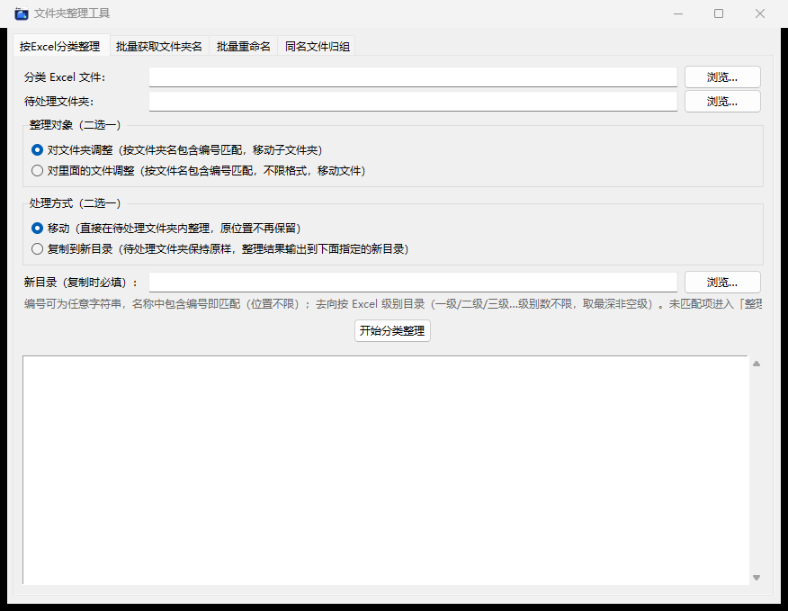

<div align="center">
  
  <h1>文件夹整理工具</h1>
  <p><strong>Folder Tidy Tool</strong></p>
  <p>按 Excel 分类、生成目录清单、批量重命名和同名文件归组的 Windows 桌面工具。</p>
  <p>A Windows desktop app for Excel-based classification, directory listings, batch renaming, and file grouping.</p>
  <p>
    <a href="#简体中文">简体中文</a> ·
    <a href="#english">English</a> ·
    <a href="https://github.com/SoulRui/folder-tidy-tool/releases/latest"><strong>下载 Windows 版 / Download</strong></a>
  </p>
  <p>
    
    
  </p>
</div>

> **注意 / Important：** “移动”会改变文件或文件夹的位置，原位重命名会替换旧名称，且不会自动保留备份。重要数据请先备份，或先使用“复制到新目录”和测试副本。 / Move and in-place rename operations change the original layout and do not create automatic backups. Back up important data or start with copy mode and test files.

---

## 简体中文

### 功能简介

- **按 Excel 分类整理**：根据编号与层级目录，批量移动或复制顶层子文件夹、文件。
- **生成目录清单**：递归列出所有子文件夹和文件，输出带层级路径和大小的 Excel 清单。
- **按 Excel 批量重命名**：读取“旧名称 → 新名称”映射，处理子文件夹或文件。
- **同名文件归组**：按完整文件名或前 N 位字符创建文件夹并移入文件，适用于 Shapefile 等多文件数据集。
- **拖拽与路径记忆**：可将文件或文件夹拖入输入框；在本地记住上次使用的路径。
- **处理报告**：分类和重命名完成后生成带时间戳的 Excel 结果报告。

软件界面目前为简体中文，本主页同时提供英文说明。所有文件都在本机处理，不会由本工具上传到网络。

### 界面

<p align="center">
  
</p>

### 下载与运行

1. 打开 **[Releases 页面](https://github.com/SoulRui/folder-tidy-tool/releases/latest)**。
2. 下载 **`folder-tidy-tool-v1.0.0-windows-x64.exe`**。
3. 双击运行，无需安装 Python、Excel 或其他运行环境。
4. 发布程序为 **Windows 64 位免安装版本**，已包含 openpyxl 和拖拽组件。
5. 程序未购买代码签名证书，Windows SmartScreen 可能显示提示。请只从本仓库 Releases 下载，并核对发布页提供的 SHA-256；也可以检查源码后自行运行。

校验命令：

```powershell
certutil -hashfile "folder-tidy-tool-v1.0.0-windows-x64.exe" SHA256
```

### 一、按 Excel 分类整理

1. 在“按Excel分类整理”选项卡中选择分类 Excel 和待处理文件夹。
2. 选择“对文件夹调整”或“对里面的文件调整”。只处理待处理目录的**顶层项目**，不会递归移动更深层的内容。
3. 选择“移动”或“复制到新目录”。复制模式的输出目录建议放在待处理目录之外。
4. 确认后点击“开始分类整理”，查看日志和结果报告。

匹配与输出规则：

- 表头可位于前 10 行；编号列支持“编号、文件夹名、文件名、名称、ID、图号”等相近名称。
- 层级列支持“一级、二级、三级……”或“第1级、第2级……”，层数不限，使用最深非空层级。
- 编号可以是文字、数字或混合字符串。名称中**包含编号**即可匹配；多个编号命中时取最长者，匹配不区分大小写。
- 未匹配项目进入 `整理失败`；目标位置已有同名项目时跳过并记录冲突，不覆盖现有内容。
- 分类表中的编号层级均为空时跳过该项目。
- 输出 `整理结果报告_时间戳.xlsx`，包含逐项结果和汇总。

示例分类表（仓库中的 [classification-example.xlsx](examples/classification-example.xlsx)）：

| 编号 | 一级 | 二级 | 三级 |
| --- | --- | --- | --- |
| DEMO-001 | 示例项目 | 区域A | 有树 |
| DEMO-002 | 示例项目 | 区域A | 无树 |
| DEMO-003 | 示例项目 | 区域B | 道路 |

例如，`DEMO-001 外业照片` 文件夹会归入 `示例项目/区域A/有树/DEMO-001 外业照片`。

### 二、生成目录清单

1. 打开“批量获取文件夹名”选项卡。
2. 选择要扫描的文件夹。
3. 可选：选择比对 Excel，为顶层文件夹标注分类去向；也可以指定清单保存位置。
4. 点击“生成目录清单”。

清单包含名称、类型、相对路径、深度、分级路径列及文件大小（KB）。未指定保存位置时，在扫描目录下生成 `目录清单_时间戳.xlsx`。

### 三、按 Excel 批量重命名

1. 打开“批量重命名”选项卡，选择重命名 Excel 和待处理文件夹。
2. 选择只处理子文件夹或只处理文件，再选择原位重命名或复制到新目录。
3. 点击“开始批量重命名”，查看日志和 `重命名结果报告_时间戳.xlsx`。

Excel 规则：

- 自动识别前 10 行中含“旧/原/old/before”和“新/new/after”的表头列。
- 无表头时按 **A 列旧名称、B 列新名称**处理。
- 文件优先按去扩展名匹配；新名称不带扩展名时保留原扩展名。
- 未匹配项目不处理；目标重名时跳过并记录冲突。

示例：[rename-example.xlsx](examples/rename-example.xlsx)

| 旧名称 | 新名称 |
| --- | --- |
| DEMO-001 | 示例地块_001 |
| Old Folder | 新文件夹 |
| draft | 报告_最终 |

### 四、同名文件归组

在“同名文件归组”选项卡中选择文件所在目录，然后选择：

- **按完整文件名**：`name.shp`、`name.shx`、`name.dbf` 等移入 `name` 文件夹。
- **按文件名前 N 位**：以文件名前 N 个字符作为文件夹名。
- **扩展名过滤**：例如 `jpg,shp`，留空表示处理全部文件。

此功能只处理顶层文件，使用移动方式；目标冲突时跳过，不覆盖已有文件。

### Excel 与数据安全说明

- 支持 `.xlsx` 和 `.xlsm`。旧版 `.xls` 请先另存为 `.xlsx`。
- “移动”和原位重命名不提供自动备份或撤销；复制模式会保留原位置内容。
- 输出目录不要与源目录相同，建议设置在源目录之外。
- 路径配置仅保存在本机 `%APPDATA%/文件夹整理工具/config.json`。
- 发布附带的两个 Excel 均为虚构演示数据，可用于安全试跑。

### SoulRui 统一图标模板

本项目的图标采用固定的品牌顶部和可替换的应用图案：

- `assets/soulrui-avatar.png`：GitHub 头像。
- `assets/icon.svg`：可编辑模板。保留最上层的 `soulrui-brand` 组，替换 `app-artwork` 组即可用于其他应用。
- `assets/icon.png`：512 × 512 PNG。
- `assets/icon.ico`：包含 16、24、32、48、64、128、256 像素，并为小尺寸进行锐化。

头像与外框使用相同比例的 R 角。以后制作新应用时，保持“头像 + SoulRui 字标 + 青色分隔线”不变，只更换底部图案。

### 从源码运行

要求：Windows、Python 3.10 或更高版本，以及 Python 自带的 tkinter。

在项目根目录执行（PowerShell）：

```powershell
py -m venv .venv
.\.venv\Scripts\Activate.ps1
python -m pip install -r requirements.txt
python folder_tidy_tool.py
```

`openpyxl` 用于 Excel 读写，`tkinterdnd2` 用于拖拽导入。缺少拖拽组件时仍可运行，但需使用浏览按钮。

### 自行打包 EXE

```powershell
python -m pip install -r requirements.txt PyInstaller
pyinstaller --clean "文件夹整理工具.spec"
```

输出位于 `dist/文件夹整理工具.exe`。打包配置已包含窗口图标、EXE 图标和拖拽组件资源。

### 命令行用法

以下示例使用 Release 附件文件名；自行打包时请换成实际 EXE 路径。

```powershell
# 分类整理：文件夹和文件，复制到新目录
.\folder-tidy-tool-v1.0.0-windows-x64.exe classify "D:\Demo\classification.xlsx" "D:\Demo\Input" both copy "D:\Demo\Output"

# 按 Excel 重命名子文件夹（原位移动）
.\folder-tidy-tool-v1.0.0-windows-x64.exe rename "D:\Demo\rename.xlsx" "D:\Demo\Input" dirs move

# 递归生成目录清单
.\folder-tidy-tool-v1.0.0-windows-x64.exe scan "D:\Demo\Input" "D:\Demo\listing.xlsx"

# 同名不同扩展名文件归组
.\folder-tidy-tool-v1.0.0-windows-x64.exe group "D:\Demo\Input" full

# 按文件名前 5 位归组，只处理 jpg 和 shp
.\folder-tidy-tool-v1.0.0-windows-x64.exe group "D:\Demo\Input" prefix 5 jpg,shp
```

窗口版 EXE 的终端日志可能不可见；需要完整控制台输出时，可使用 `python folder_tidy_tool.py ...` 运行相同命令。移动类命令请先使用测试副本。

### 项目结构

```text
folder-tidy-tool/
├── assets/                       # SoulRui 品牌头像、SVG 模板、PNG 和 ICO
├── docs/images/                  # 不含历史路径的界面截图
├── examples/                     # 虚构分类与重命名 Excel 示例
├── folder_tidy_tool.py           # GUI、Excel 处理与 CLI
├── 文件夹整理工具.spec            # PyInstaller 配置
├── requirements.txt
└── README.md
```

### 许可

目前尚未单独指定开源许可证。公开源代码不等同于授予复制、修改或再分发的开源授权。

---

## English

### Overview

Folder Tidy Tool is a Windows desktop app for repetitive file and folder organization:

- **Excel-based classification**: move or copy top-level folders/files into category paths from an Excel workbook.
- **Directory listings**: recursively export folder/file names, relative paths, hierarchy columns, and sizes to Excel.
- **Batch renaming**: apply an old-name-to-new-name Excel mapping to folders or files.
- **File grouping**: group files by full basename or a prefix of N characters, useful for multi-file datasets such as Shapefiles.
- **Drag and drop and remembered paths**: drop items onto path fields and remember recent locations locally.
- **Excel reports**: classification and renaming produce timestamped result reports.

The interface is currently in Simplified Chinese, with full English documentation below. Processing is local; the app does not upload your files.

### Screenshot

<p align="center">
  
</p>

### Download and run

1. Open the **[Releases page](https://github.com/SoulRui/folder-tidy-tool/releases/latest)**.
2. Download **`folder-tidy-tool-v1.0.0-windows-x64.exe`**.
3. Double-click it. Python, Microsoft Excel, and additional runtimes are not required.
4. The portable **64-bit Windows** build includes openpyxl and drag-and-drop resources.
5. The executable is not digitally signed with a purchased code-signing certificate, so SmartScreen may warn you. Download only from this repository and compare the SHA-256 in the release notes, or inspect and run the source yourself.

```powershell
certutil -hashfile "folder-tidy-tool-v1.0.0-windows-x64.exe" SHA256
```

### Using the four tools

#### 1. Classify with Excel

Choose a classification workbook and an input folder. Select folders or files, then choose move or copy-to-new-directory. Only **top-level items** in the input directory are processed.

- Header detection scans the first 10 rows and recognizes ID/name columns plus arbitrary numbered hierarchy levels.
- An item matches when its name contains an ID from the workbook. Matching is case-insensitive, and the longest matching ID wins.
- Empty category paths are skipped. Unmatched items go to `整理失败`; same-name destination conflicts are skipped without overwriting.
- A `整理结果报告_时间戳.xlsx` report records each result and a summary.

Use the fictional [classification-example.xlsx](examples/classification-example.xlsx) for a safe trial:

| ID | Level 1 | Level 2 | Level 3 |
| --- | --- | --- | --- |
| DEMO-001 | 示例项目 | 区域A | 有树 |
| DEMO-002 | 示例项目 | 区域A | 无树 |
| DEMO-003 | 示例项目 | 区域B | 道路 |

For example, a folder named `DEMO-001 field photos` is classified under `示例项目/区域A/有树`.

#### 2. Generate a directory listing

Select a folder to scan, optionally choose a comparison workbook and output path, then generate the report. The workbook includes names, types, relative paths, depth, hierarchy columns, and sizes in KB. If no output path is provided, `目录清单_时间戳.xlsx` is created in the scanned directory.

#### 3. Rename with Excel

Select a rename workbook and input directory, choose folders or files, and select in-place rename or copy mode.

- The first 10 rows are scanned for old/original and new name headers.
- Without a recognized header, column A is the old name and column B is the new name.
- Files are matched by basename first. Original extensions are preserved when the new name has no extension.
- Unmatched items and destination conflicts are not overwritten. A timestamped Excel report is generated.

Try the fictional [rename-example.xlsx](examples/rename-example.xlsx).

#### 4. Group same-named files

Group top-level files by full basename (`name.shp`, `name.shx`, and `name.dbf` go into `name`) or by the first N characters. An optional extension filter such as `jpg,shp` limits the processed files. This operation moves files and skips destination conflicts.

### Excel support and safety

- Use `.xlsx` or `.xlsm`. Save legacy `.xls` files as `.xlsx` first.
- Move and in-place rename operations do not create backups and do not provide undo. Copy mode preserves source items.
- Do not use the source directory as the output directory. An external output directory is recommended.
- Recent paths are stored only in `%APPDATA%/文件夹整理工具/config.json`.
- Both included workbooks contain fictional demonstration data.

### Reusable SoulRui icon template

The icon has a fixed brand header and replaceable application artwork:

- `assets/soulrui-avatar.png`: the GitHub avatar.
- `assets/icon.svg`: editable source. Keep the top-level `soulrui-brand` group unchanged and replace `app-artwork` for another app.
- `assets/icon.png`: 512 × 512 PNG.
- `assets/icon.ico`: 16, 24, 32, 48, 64, 128, and 256 px variants with small-size sharpening.

The avatar and outer tile use proportional corner radii. Keep the avatar, SoulRui wordmark, and cyan divider unchanged; replace only the lower artwork for future applications.

### Run from source

Requirements: Windows, Python 3.10 or later, and tkinter.

```powershell
py -m venv .venv
.\.venv\Scripts\Activate.ps1
python -m pip install -r requirements.txt
python folder_tidy_tool.py
```

openpyxl handles Excel files, and tkinterdnd2 enables drag and drop. Without the optional drag-and-drop package, the GUI still runs with browse buttons.

### Build the executable

```powershell
python -m pip install -r requirements.txt PyInstaller
pyinstaller --clean "文件夹整理工具.spec"
```

The result is `dist/文件夹整理工具.exe`. The spec includes window/executable icons and drag-and-drop resources.

### Command line

The examples below use the release asset name. Replace it with your actual executable path if you build it yourself.

```powershell
# Classify folders and files into a separate output directory
.\folder-tidy-tool-v1.0.0-windows-x64.exe classify "D:\Demo\classification.xlsx" "D:\Demo\Input" both copy "D:\Demo\Output"

# Rename folders in place
.\folder-tidy-tool-v1.0.0-windows-x64.exe rename "D:\Demo\rename.xlsx" "D:\Demo\Input" dirs move

# Export a recursive directory listing
.\folder-tidy-tool-v1.0.0-windows-x64.exe scan "D:\Demo\Input" "D:\Demo\listing.xlsx"

# Group by complete basename
.\folder-tidy-tool-v1.0.0-windows-x64.exe group "D:\Demo\Input" full

# Group by a five-character prefix and filter extensions
.\folder-tidy-tool-v1.0.0-windows-x64.exe group "D:\Demo\Input" prefix 5 jpg,shp
```

Console output may not be visible in the windowed EXE. Use `python folder_tidy_tool.py ...` when you need full terminal logs. Test move operations on copies first.

### Project layout

```text
folder-tidy-tool/
├── assets/                       # SoulRui avatar, SVG template, PNG, and ICO
├── docs/images/                  # Screenshot with no remembered private paths
├── examples/                     # Fictional classification and rename workbooks
├── folder_tidy_tool.py           # GUI, Excel operations, and CLI
├── 文件夹整理工具.spec            # PyInstaller configuration
├── requirements.txt
└── README.md
```

### License

No separate open-source license has been specified yet. Making the source public does not, by itself, grant open-source rights to copy, modify, or redistribute it.
